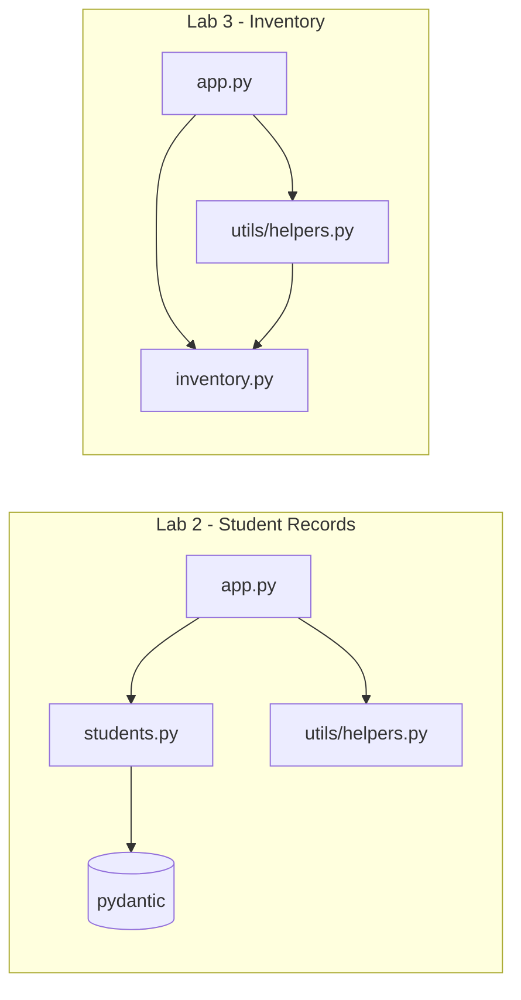
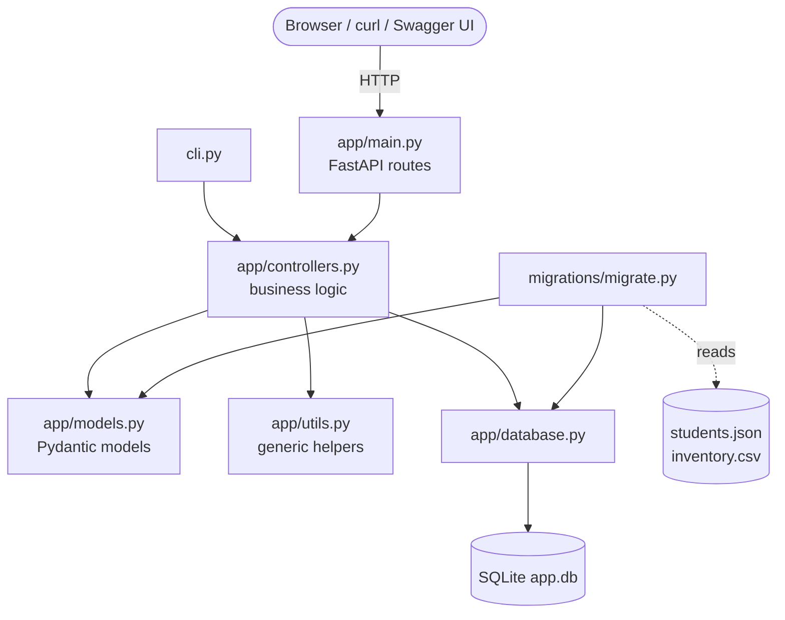
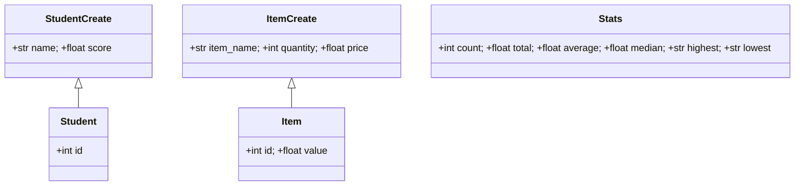
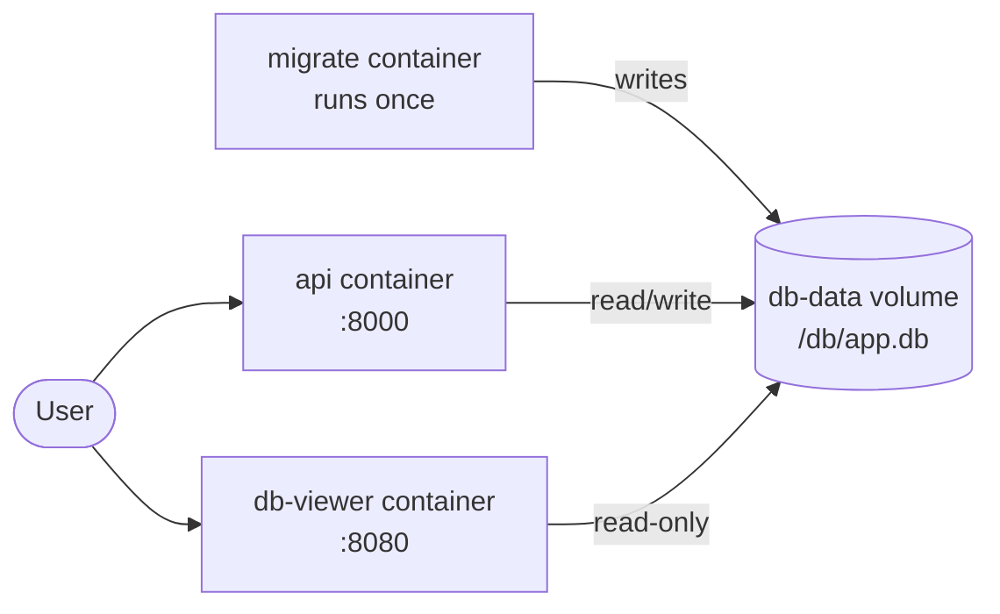

# Lab 4 - Reverse Engineering & Design Notes

## 1. Reverse engineering: the system *before* (Labs 2 & 3)

### Inventory of functions and classes

| Module | Functions / classes | Notes |
|--------|--------------------|-------|
| `students.py` (Lab 2) | `Student` (Pydantic), `students` list, `add_student`, `average_score`, `median_score`, `grade`, `format_report`, `print_report` | Data, validation, statistics **and** printing in one file |
| `utils/helpers.py` (Lab 2) | `highest_score`, `lowest_score` | |
| `app.py` (Lab 2) | `main`, `show_extremes`, `demo_validation` | |
| `inventory.py` (Lab 3) | `Item` (dataclass), `items` list | Data hard-coded in source |
| `utils/helpers.py` (Lab 3) | `highest_stock_item`, `lowest_stock_item`, `naira` | Duplicates Lab 2 helpers |
| `app.py` (Lab 3) | `total_stock_value`, `low_stock_items`, `stock_status`, `print_table`, `print_summary`, `main` | Business logic mixed with output |

### Dependency diagram (before)



### Code smells / areas of high coupling found

| # | Smell | Where | Why it is a problem |
|---|-------|-------|---------------------|
| 1 | **Duplicated code** | `highest_score`/`lowest_score` vs `highest_stock_item`/`lowest_stock_item` | Same logic written 4 times - a bug fix must be made 4 times |
| 2 | **Hard-coded data** | `students` and `items` lists inside source files | Data changes need a code change + commit; nothing is saved between runs |
| 3 | **Mixed responsibilities** | `students.py` does data + validation + stats + printing | Hard to reuse (e.g. from a web API) or test |
| 4 | **Global mutable state** | `add_student()` appends to a module-level list | Hidden side effects, not thread-safe, lost on restart |
| 5 | **Output coupled to logic** | `print_*` functions in `app.py` | Logic can only be used from the console |
| 6 | **No external interface** | Console only | Other systems cannot use the data |

## 2. Refactored design (after)

```
lab4_reengineering/
├── app/
│   ├── models.py        # Pydantic models: StudentCreate/Student, ItemCreate/Item, Stats
│   ├── database.py      # SQLite connection + schema (DB_PATH env var)
│   ├── controllers.py   # Business logic: CRUD + statistics
│   ├── utils.py         # Generic helpers: highest_by, lowest_by, mean, median, naira
│   └── main.py          # FastAPI routes (REST API)
├── migrations/migrate.py  # JSON/CSV  ->  SQLite
├── data/                # students.json, inventory.csv (legacy data sources)
├── cli.py               # Console report, now reading from SQLite
├── tests/test_api.py    # Automated end-to-end tests
├── docker/              # api.Dockerfile, migrate.Dockerfile
└── docker-compose.yml   # migrate + api + db-viewer
```

### Module dependency diagram (after)



### Class diagram (models)



### Deployment diagram (Docker Compose)



## 3. How each smell was fixed

| Smell | Fix |
|-------|-----|
| Duplicated helpers | One pair of generic functions `highest_by(records, key)` / `lowest_by(records, key)` in `utils.py` (DRY) |
| Hard-coded data | Data moved to SQLite; `migrate.py` imports the legacy JSON/CSV once |
| Mixed responsibilities | Layered: models -> database -> controllers -> API/CLI |
| Global mutable state | Database replaces module-level lists |
| Output coupled to logic | Controllers return data; `main.py` (JSON) and `cli.py` (text) only present it |
| No external interface | RESTful FastAPI with automatic Swagger docs |
